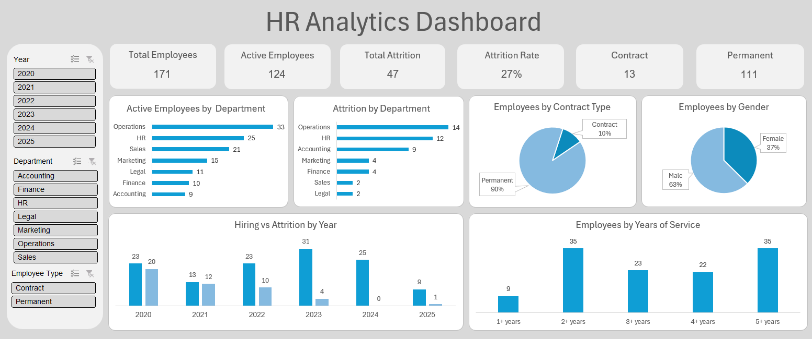

# 📊 HR Analytics Dashboard | Employee Insights & Workforce Analysis

## 1. Project Overview

This project focuses on analyzing Human Resources (HR) data and developing an interactive **HR Analytics Dashboard using Microsoft Excel** to provide insights into workforce composition, employee hiring, attrition, and employee stability.

The dashboard transforms raw employee data into meaningful visualizations and key performance indicators (KPIs), helping HR teams understand workforce trends, monitor employee turnover, and make data-driven decisions.

The project includes three main worksheets:

- **Raw Data:** Contains the original employee dataset.
- **Pivot Data:** Contains Pivot Tables used to summarize HR data, generate key metrics, and create dashboard charts.
- **HR Dashboard:** Presents an interactive visual overview of key HR insights.

## 2. Project Objectives

Develop an interactive dashboard to:

- Evaluate employee attrition and retention patterns.
- Analyze workforce composition and employee distribution.
- Monitor hiring trends and workforce changes over time.
- Identify potential workforce challenges and areas for improvement.
- Support strategic HR planning through data-driven insights.

## 3. Dashboard Overview

The HR Analytics Dashboard provides a comprehensive overview of workforce performance through KPIs, charts, and interactive filters.

### Key Performance Indicators (KPIs)

The dashboard highlights six main metrics:

| KPI | Result |
|---|---:|
| Total Employees | 171 |
| Active Employees | 124 |
| Total Attrition | 47 |
| Attrition Rate | 27% |
| Contract Employees | 13 |
| Permanent Employees | 111 |

### Dashboard Visualizations

**1. Active Employees by Department**
- Shows the number of active employees in each department.

**2. Attrition by Department**
- Displays employee attrition across different departments..

**3. Employees by Contract Type**
- Visualizes workforce distribution between contract and permanent employees.

**4. Employees by Gender**
- Displays the gender distribution across the workforce.

**5. Hiring vs. Attrition by Year**
- Compares annual hiring and attrition figures from 2020 to 2025.

**6. Employees by Years of Service**
- Shows employee distribution according to years of service.

### Interactive Filters (Slicers)

The dashboard includes interactive slicers that allow users to filter the analysis by:

- Year (2020–2025)
- Department
- Employment Type (Contract / Permanent)

These filters make it easier to explore specific workforce segments and analyze HR performance from different perspectives.

## 4. Data Preparation & Cleaning

The project started with raw employee data, which was organized and prepared for analysis using Microsoft Excel.

The data preparation and cleaning process included:

- **Dataset Understanding:** Reviewed and understood the raw employee dataset.
- **Data Type Correction:** Checked and corrected data types to ensure data consistency.
- **Calculated Columns:** Created additional analytical columns, including Hiring, Attrition, and Active Flag.

## 5. Data Analysis

- **Pivot Tables:** Created Pivot Tables to summarize employee data across different HR dimensions.
- **Metric Calculation:** Used Pivot Tables to generate key HR metrics and support dashboard chart creation.
- **Interactive Analysis:** Connected Pivot Tables to interactive slicers, enabling dynamic filtering and allowing users to explore HR data from different perspectives.

## 6. Tools & Technologies

- **Microsoft Excel:** Main tool for data preparation, analysis, and dashboard development.
  - **Pivot Tables:** Used to summarize employee data and generate key HR metrics.
  - **Pivot Charts:** Used to visualize HR data and workforce trends.
  - **Slicers:** Used to create interactive dashboard filters.
  - **Excel Formulas:** Used to create additional analytical columns in the dataset.

## 7. Data Source

The project uses an employee HR dataset provided for analysis and dashboard development.

The dataset contains employee-related information, including:

- Employee ID
- Employee Name
- Employee Status
- Date of Joining
- Date of Leaving
- Reporting Manager
- Employment Type
- Gender
- Marital Status
- Department
- Total Experience
- Year
- Employee Stability

## 8. Key Insights

The analysis of 171 employee records revealed several important workforce insights:

- **Employee Attrition & Retention:** 47 employees left the organization, representing an attrition rate of 27.5%, while 124 employees (72.5%) remain active. Operations recorded the highest attrition (14 employees), followed by HR (12 employees).

- **Workforce Composition:** The active workforce consists of 111 permanent employees (89.5%) and 13 contract employees (10.5%). In terms of gender distribution, males represent 62.6% of the total workforce, compared to 37.4% females.

- **Hiring Trends:** Hiring peaked in 2023 with 31 new employees. Meanwhile, annual attrition declined from 20 employees in 2020 to just 1 employee in 2025.

- **Employee Stability:** 57 active employees (46%) have at least 4 years of service, indicating a considerable proportion of experienced employees within the organization.

- **Areas for Improvement:** The high concentration of attrition in Operations and HR highlights the need for further investigation into employee turnover. Strengthening retention strategies and continuously monitoring workforce trends can support better HR planning and decision-making.
